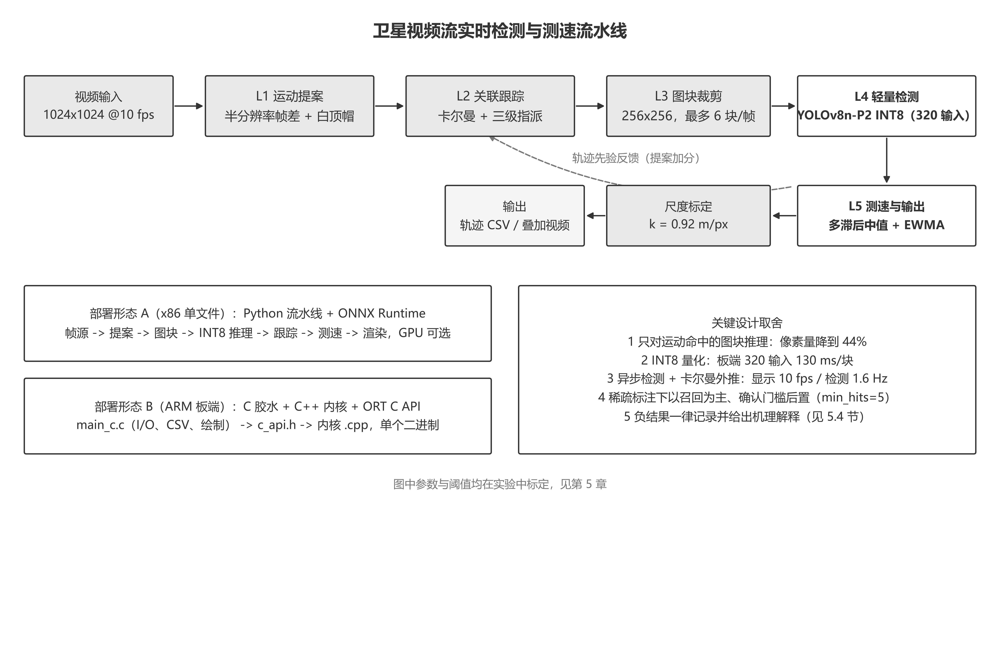

# 01 · 系统架构



## 1. 总体结构

整条流水线分五级，单帧数据流如下：

```
输入帧(BGR 1024x1024)
  └─ L1 运动提案 ── 半分辨率灰度 → 白顶帽 → 帧差二值化 → 闭运算 → 4x4 格子投票 → 取前 K 格
        └─ L2 关联跟踪 ── 已有轨迹的预测框回灌为提案先验（加分）
  └─ L3 图块裁剪 ── 每个命中格子取 256x256 图块，夹回画面内并去重
  └─ L4 轻量检测 ── 图块缩放到网络输入边长 → INT8 推理 → DFL 解码 → 跨图块 NMS
  └─ L5 测速输出 ── 卡尔曼跟踪 → 光流速度先验 → 多滞后中值测速 → CSV / 叠加视频
```

每帧只推理 K 个图块（默认 6），参与网络的像素量约为全图的 44%，
这是整套方案能在 4 核 ARM 上跑起来的前提。

## 2. 各层职责

**L1 运动提案**。输入帧一步转成半分辨率灰度图（灰度化与 2×2 面积降采样融合，省掉一次全图读写），
再用 3×3 白顶帽（I − opening(I)）抑制云、水面、道路等低频背景，保留比背景亮的 2~5 像素亮斑。
背景用指数滑动平均维护（α=0.02，约 50 帧时间常数）；当前帧与背景做绝对差、按阈值 40 二值化，
经 3×3 椭圆结构元闭运算去掉孤立噪点，最后按 4×4 格子统计运动像素数。
选格时叠加两项先验：已有轨迹的预测位置（+0.6）与"格子多久没被检查"的陈旧度（0.9×，上限 1.5）。

**L2 关联跟踪**。每个目标一个 8 状态卡尔曼滤波器（中心、宽高及其速度），
关联分三级：椭圆门限粗筛（沿速度方向放宽、横向收紧）→ 门限内匈牙利匹配 → 未匹配检测尝试复活近期消失的轨迹，
仍失败才新建。轨迹需连续命中 5 帧才被确认输出（`min_hits=5`），关联门限倍率默认 0.7。

**L3/L4 图块检测**。检测器为 YOLOv8n 加 P2 高分辨率分支（stride 4），
回归损失使用归一化高斯 Wasserstein 距离（NWD，C=8）替代 IoU，
检测头带 ECA 通道注意力，回归采用 DFL（reg_max=16）。
模型 INT8 量化后 3.47 MB，板端单图块 130 ms（320 输入）。

**L5 测速与光流先验**。像素位移经多滞后窗口（6/12/18 帧）取中位数，再指数加权平均（0.7）平滑，
并限制单帧最大 6 像素的斜率，避免框抖动放大成速度尖峰；乘以尺度系数 k=0.92 m/px 与帧率换算为 km/h。
光流先验（默认开启）用块匹配（半分辨率 ±6 像素 SAD 搜索）估计每条轨迹的位移，
按权重 1.0 融入卡尔曼速度状态，提升快速目标的关联稳定性；可用 `--no-flow` 关闭。

## 3. 两种实现

| | 加速库（`--backend native`，默认） | 纯 Python（`--backend python`） |
|---|---|---|
| 实现 | `native/src/*.cpp`，编译为 `satstream.dll` / `libsatstream.so` | `src/pipeline_py.py` |
| 覆盖范围 | L1~L5 全部（含光流、跟踪、解码、NMS） | 同上 |
| Python 侧职责 | 视频读写、绘制、CSV | 同左 |
| 接口 | `c_api.h` 五个 C 函数，ctypes 绑定 | 直接调用 |
| 适用 | 生产运行 | 无编译环境、对照实验 |

两者的算法与参数完全一致，输出在相同输入下相同；差别只在语言与调用开销。