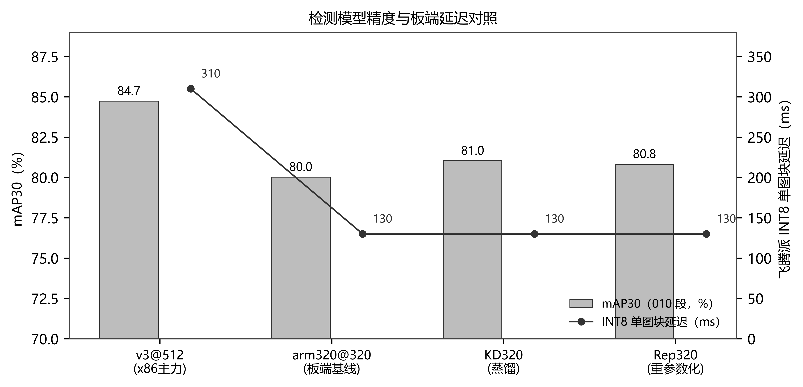
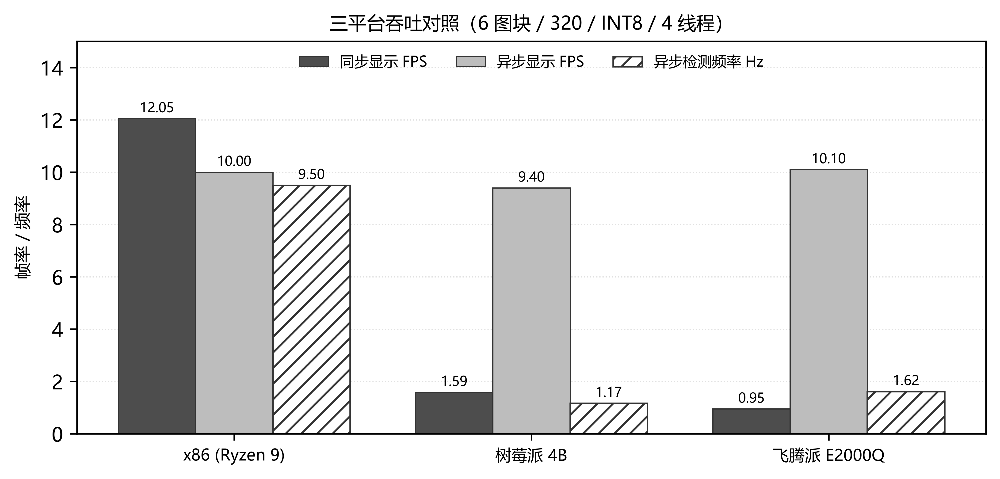

# 02 · 性能与精度

## 1. 指标口径

- **mAP30**：IoU 阈值 0.3 的平均精度。目标只有 5~10 像素，0.5 阈值下框的轻微偏移就会判负，故取 0.3。
- 评测集：固定验证序列 010（326 帧），提案使用真值框（oracle）以保证可比。

## 2. 模型（均为 320 输入、INT8 部署）

| 模型 | mAP30 | 说明 | 体积 |
|---|---|---|---|
| **kd320（默认）** | **0.8104** | 512 模型作教师做特征蒸馏 | 3.47 MB |
| arm320 | 0.8003 | 320 输入基线 | 3.47 MB |
| rep320 | 0.8083 | MobileOne 式重参数化训练，推理结构与基线完全一致 | 3.47 MB |

## 3. 平台吞吐

| 平台 | 单图块推理 | 同步端到端 | 异步（显示 / 检测） | 峰值内存 |
|---|---|---|---|---|
| 树莓派 4B（4×A72 1.8 GHz 同构） | ~103 ms | 705.5 ms/帧（1.42 FPS） | 9.4 fps / 1.17 Hz | 119.8 MB |
| 飞腾派 E2000Q（2×1.8 + 2×1.5 GHz） | ~148 ms | **944.1 ms/帧（1.06 FPS）** | 10.1 fps / 1.62 Hz | 121 MB |

> 计量口径：上表均为**稳态**（连续 30 帧）结果。短帧数（≤10 帧）会被约 2 s 的模型加载时间摊进平均值，
> 出现过 8 帧测出 944 ms、30 帧测出 705 ms 的偏差，跨平台比较时必须用同一帧数且已进入稳态。

## 4. 耗时构成（树莓派 4B，6 图块）

| 阶段 | 每帧耗时 | 占比 |
|---|---|---|
| 运动提案（含白顶帽） | 12.0 ms | 2% |
| 推理 | 591.6 ms | 94% |
| 跟踪 + 测速 + 光流 | 8.9 ms | 1.4% |
| 其余（读帧、绘制、CSV） | 18 ms | 3% |

板端瓶颈完全在推理：6 图块时推理占端到端 88%（树莓派 620/705 ms），
因此调参的第一优先级是 `--max-cells`，其次才是输入分辨率。

## 4.1 飞腾派的 CPU 拓扑与绑核

飞腾派 E2000Q 是**异构 2+2**，不是四个同构核：

| 核 | 最大频率 | cpu_capacity |
|---|---|---|
| cpu2, cpu3 | 1.8 GHz | 1024（大核） |
| cpu0, cpu1 | 1.5 GHz | 429（小核） |

同一份模型、同样 6 图块，绑核位置直接决定吞吐：

| 配置 | ms/帧 | FPS | 相对默认 |
|---|---|---|---|
| 4 线程，不绑核 | 1088.5 | 0.92 | — |
| 4 线程，绑小核 cpu0,1 | 2206.0 | 0.45 | −51% |
| 4 线程，绑大核 cpu2,3 | 956.2 | 1.05 | +12% |
| **2 线程，绑大核 cpu2,3（默认）** | **944.1** | **1.06** | **+15%** |

结论：① 落到小核上性能腰斩，必须避免；② 大核只有 2 个，线程数超过 2 没有收益；
③ 程序在飞腾派上自动采用"2 线程 + 绑大核"，`--pin-cores none` 可关闭。

## 5. 图块预算

| 每帧图块数 | 1 | 2 | 3 | 4 | 6 |
|---|---|---|---|---|---|
| 提案召回 | 18% | 45% | 66% | 78% | 97% |

若需要更高显示帧率，可把 `--max-cells` 降到 4（召回 78%，推理时间约降三成），
或用异步检测：显示维持 10 fps，检测按硬件能力跑。