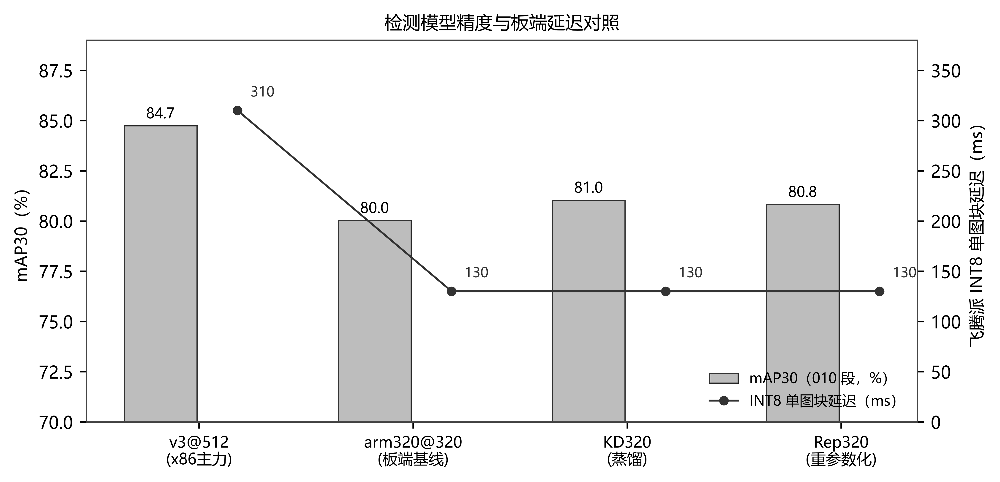
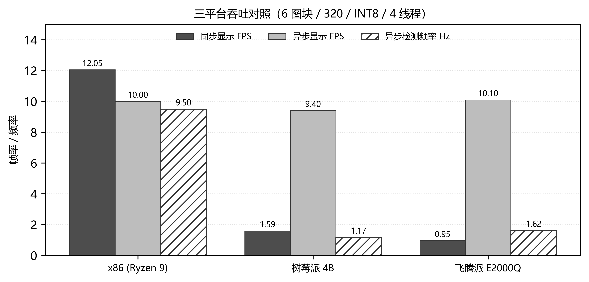

# 02 · 性能与精度

## 1. 指标口径

- **mAP30**：IoU 阈值 0.3 的平均精度。目标只有 5~10 像素，0.5 阈值下框的轻微偏移就会判负，故取 0.3。
- **mAP50 / mAP50-95**：常规指标，用于横向参考。
- **召回（按尺寸分桶）**：`recall_lt4px` 等，按真值框最长边分档统计。
- 评测集：固定验证序列 010（326 帧），提案使用真值框（oracle）以保证可比。

## 2. 模型

| 模型 | 输入 | mAP30 | mAP50 | F1 | 召回 | 精确率 | 体积 |
|---|---|---|---|---|---|---|---|
| **v3（默认）** | 512 | **0.8474** | 0.7235 | 0.8015 | 0.793 | 0.810 | 3.47 MB (int8) |
| full | 512 | 0.8379 | 0.7020 | 0.7971 | 0.778 | 0.817 | 12.24 MB (fp32) |
| full2 | 512 | 0.8281 | 0.7186 | 0.7892 | 0.791 | 0.787 | 12.24 MB (fp32) |
| arm320（参考） | 320 | 0.8003 | — | — | — | — | 3.47 MB (int8) |

## 3. 平台吞吐

| 平台 | 输入 | 单图块推理 | 端到端（6 图块/帧） |
|---|---|---|---|
| x86 Ryzen 9 8945HX（4 线程） | 512 | 26.5 ms | 189 ms/帧（5.3 FPS） |
| x86 Ryzen 9 8945HX（4 线程） | 320 | 12.0 ms | 83 ms/帧（12.1 FPS） |
| 树莓派 4B（4×A72 1.8 GHz） | 320 | 98.6 ms | 630.9 ms/帧（1.59 FPS） |
| 飞腾派 E2000Q（4×1.5 GHz） | 320 | 130 ms | 1050 ms/帧（0.95 FPS） |

## 4. 耗时构成（树莓派 4B，320 输入，6 图块）

| 阶段 | 每帧耗时 | 占比 |
|---|---|---|
| 运动提案（含白顶帽） | 12.0 ms | 2% |
| 推理 | 591.6 ms | 94% |
| 跟踪 + 测速 + 光流 | 8.9 ms | 1.4% |
| 其余（读帧、绘制、CSV） | 18 ms | 3% |

结论：板端瓶颈完全在推理，算法侧优化的重点是"少推理几块"而不是"每块算得更快"。

## 5. 图块预算

每帧推理块数与提案召回（真值框中心落入某提案图块即算命中）：

| 每帧图块数 | 1 | 2 | 3 | 4 | 6 |
|---|---|---|---|---|---|
| 提案召回 | 18% | 45% | 66% | 78% | 97% |

块数超过 6 之后召回增长趋缓，而推理时间线性上升，故默认 6 块。